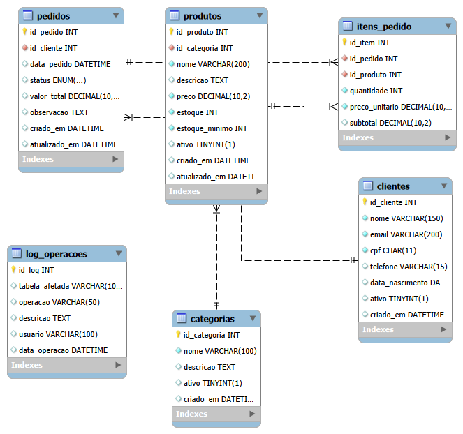

# Sistema de Gestão de Loja de Tecnologia - TechStore

Projeto acadêmico de banco de dados relacional desenvolvido em MySQL, com o objetivo de organizar as informações de uma loja de produtos de tecnologia (e-commerce) e centralizar as regras de negócio por meio de stored procedures.



## 1. Pré-requisitos

- MySQL Server 8.0.13 ou superior.
- MySQL Workbench, ou outra ferramenta compatível com MySQL.

## 2. Contextualização

A TechStore vende notebooks, celulares, periféricos, monitores e dispositivos de armazenamento. À medida que o catálogo e o volume de pedidos crescem, algumas operações do dia a dia tornam-se difíceis de controlar:

- Reajustar preços de uma categoria inteira produto por produto, sem limites definidos.
- Registrar cadastros e alterações sem deixar rastro.
- Consultar o histórico de um cliente, com pedidos e valores, em várias consultas separadas.
- Garantir que cada sistema (site, aplicativo ou sistema interno) aplique as mesmas regras.

O projeto resolve esses pontos ao concentrar a lógica de negócio no próprio banco. As operações são executadas por stored procedures, que validam os dados antes de alterá-los, registram as ações relevantes em uma tabela de auditoria e devolvem resultados padronizados.

## 3. Objetivos

- Aplicar os conceitos de stored procedures do MySQL na prática.
- Utilizar parâmetros de entrada (`IN`) e de saída (`OUT`) nas rotinas.
- Implementar validações de regras de negócio antes de alterar os dados.
- Retornar múltiplos conjuntos de resultados em uma única chamada.
- Registrar operações relevantes na tabela de auditoria `log_operacoes`.
- Desenvolver consultas que auxiliem a tomada de decisão em diferentes setores da loja.

## 4. Tecnologias Utilizadas

- **MySQL:** sistema gerenciador de banco de dados.
- **MySQL Workbench:** criação, execução e testes dos scripts.
- **SQL:** criação de tabelas, inserção de dados, consultas e stored procedures.
- **GitHub:** armazenamento e compartilhamento dos scripts do projeto.

## 5. Modelagem do Banco de Dados

O banco `loja_tech` é composto por seis tabelas relacionadas. O diagrama EER no topo deste documento mostra a estrutura completa.

### 5.1 Tabelas

**categorias**: agrupa os produtos por tipo.

| Campo | Tipo | Descrição |
|---|---|---|
| `id_categoria` | INT | Chave primária, com autoincremento. |
| `nome` | VARCHAR(100) | Nome da categoria, obrigatório. |
| `descricao` | TEXT | Descrição da categoria. |
| `ativo` | BOOLEAN | Indica se a categoria está ativa. Padrão: verdadeiro. |
| `criado_em` | DATETIME | Data de criação. Padrão: data atual. |

**produtos**: catálogo de produtos à venda.

| Campo | Tipo | Descrição |
|---|---|---|
| `id_produto` | INT | Chave primária, com autoincremento. |
| `id_categoria` | INT | Chave estrangeira para `categorias`. |
| `nome` | VARCHAR(200) | Nome do produto, obrigatório. |
| `descricao` | TEXT | Descrição do produto. |
| `preco` | DECIMAL(10,2) | Preço unitário, obrigatório. |
| `estoque` | INT | Quantidade em estoque. Padrão: 0. |
| `estoque_minimo` | INT | Quantidade mínima desejada em estoque. Padrão: 5. |
| `ativo` | BOOLEAN | Indica se o produto está à venda. Padrão: verdadeiro. |
| `criado_em` | DATETIME | Data de criação. |
| `atualizado_em` | DATETIME | Data da última atualização. |

**clientes**: cadastro dos clientes da loja.

| Campo | Tipo | Descrição |
|---|---|---|
| `id_cliente` | INT | Chave primária, com autoincremento. |
| `nome` | VARCHAR(150) | Nome do cliente, obrigatório. |
| `email` | VARCHAR(200) | E-mail, obrigatório e único. |
| `cpf` | CHAR(11) | CPF, obrigatório e único. |
| `telefone` | VARCHAR(15) | Telefone de contato. |
| `data_nascimento` | DATE | Data de nascimento. |
| `ativo` | BOOLEAN | Indica se o cadastro está ativo. Padrão: verdadeiro. |
| `criado_em` | DATETIME | Data do cadastro. |

**pedidos**: registro dos pedidos realizados pelos clientes.

| Campo | Tipo | Descrição |
|---|---|---|
| `id_pedido` | INT | Chave primária, com autoincremento. |
| `id_cliente` | INT | Chave estrangeira para `clientes`. |
| `data_pedido` | DATETIME | Data e hora do pedido. |
| `status` | ENUM | Situação do pedido: `pendente`, `processando`, `enviado`, `entregue` ou `cancelado`. Padrão: `pendente`. |
| `valor_total` | DECIMAL(10,2) | Valor total do pedido. Padrão: 0,00. |
| `observacao` | TEXT | Observações do pedido. |
| `criado_em` | DATETIME | Data de criação do registro. |
| `atualizado_em` | DATETIME | Data da última atualização. |

**itens_pedido**: detalha os produtos de cada pedido.

| Campo | Tipo | Descrição |
|---|---|---|
| `id_item` | INT | Chave primária, com autoincremento. |
| `id_pedido` | INT | Chave estrangeira para `pedidos`. |
| `id_produto` | INT | Chave estrangeira para `produtos`. |
| `quantidade` | INT | Quantidade do produto no pedido. Padrão: 1. |
| `preco_unitario` | DECIMAL(10,2) | Preço do produto no momento da compra. |
| `subtotal` | DECIMAL(10,2) | Calculado automaticamente: quantidade multiplicada pelo preço unitário. |

**log_operacoes**: auditoria das operações realizadas pelas stored procedures.

| Campo | Tipo | Descrição |
|---|---|---|
| `id_log` | INT | Chave primária, com autoincremento. |
| `tabela_afetada` | VARCHAR(100) | Nome da tabela alterada pela operação. |
| `operacao` | VARCHAR(50) | Tipo da operação, como `UPDATE_PRECO`. |
| `descricao` | TEXT | Detalhes da operação. |
| `usuario` | VARCHAR(100) | Usuário do banco que executou a operação. |
| `data_operacao` | DATETIME | Data e hora da operação. |

### 5.2 Relacionamentos e cardinalidade

- **Categorias e produtos (1:N):** uma categoria pode possuir vários produtos, mas cada produto pertence a uma única categoria.
- **Clientes e pedidos (1:N):** um cliente pode realizar vários pedidos, mas cada pedido pertence a um único cliente.
- **Pedidos e itens de pedido (1:N):** um pedido pode conter vários itens, mas cada item pertence a um único pedido.
- **Produtos e itens de pedido (1:N):** um produto pode aparecer em vários itens de pedido, mas cada item refere-se a um único produto.

A tabela `log_operacoes` não possui chave estrangeira. Ela registra as operações de forma independente, para que o histórico seja preservado.

A integridade referencial é garantida pelas chaves estrangeiras, que impedem, por exemplo, a criação de um pedido para um cliente inexistente.

## 6. Consultas SQL Desenvolvidas

O arquivo `queries.sql` contém dez consultas, cada uma respondendo a uma necessidade de um setor da loja:

| Nº | Situação | Recursos utilizados |
|---|---|---|
| 1 | O marketing precisa do nome e do e-mail de todos os clientes para um comunicado geral. | `SELECT`, `FROM` |
| 2 | A vitrine promocional precisa de produtos que custem menos de R$ 500,00. | `WHERE` com comparação |
| 3 | A equipe de atendimento precisa ver todos os dados dos pedidos pendentes. | `WHERE` com igualdade |
| 4 | O catálogo deve ser exibido do produto mais caro para o mais barato. | `ORDER BY ... DESC` |
| 5 | O cliente quer ver os produtos cujo nome contém "Monitor". | `LIKE` |
| 6 | O gerente de logística quer os periféricos com mais de 40 unidades em estoque. | `WHERE` composto com `AND` |
| 7 | A gerência quer o total de clientes cadastrados. | `COUNT(*)` com alias |
| 8 | A diretoria quer o faturamento bruto, somando todos os pedidos. | `SUM()` com alias |
| 9 | Para facilitar a leitura do catálogo, cada produto deve aparecer com o nome da sua categoria. | `INNER JOIN` |
| 10 | O atendimento quer os pedidos de uma cliente específica. | `INNER JOIN` com `WHERE` |

## 7. Stored Procedures Desenvolvidas

O arquivo `stored_procedure.sql` cria sete procedures. Elas estão organizadas em três grupos: consultas, cadastro e atualização de dados, e cálculos com retorno por parâmetro.

### 7.1 Procedures de consulta

**listar_categorias_ativas**

Lista as categorias ativas, com id, nome e descrição, em ordem alfabética.

- Parâmetros: nenhum.
- Retorno: um conjunto de resultados.

**buscar_pedidos_por_status**

Retorna os pedidos que possuem o status informado.

- Parâmetros: `IN p_status VARCHAR(20)`, com valores como `pendente`, `processando`, `enviado`, `entregue` ou `cancelado`.
- Retorno: um conjunto de resultados com `id_pedido`, `id_cliente`, `data_pedido` e `valor_total`.

**consultar_extrato_cliente**

Gera o extrato de um cliente em três conjuntos de resultados: dados cadastrais, lista de pedidos e resumo financeiro. O resumo considera apenas pedidos não cancelados. Se o cliente não existir, a procedure retorna uma mensagem de erro.

- Parâmetros: `IN p_id_cliente INT`.
- Retorno: três conjuntos de resultados ou uma mensagem de erro.

### 7.2 Procedures de cadastro e atualização

**inserir_categoria**

Cadastra uma nova categoria. As colunas `ativo` e `criado_em` recebem os valores padrão da tabela.

- Parâmetros: `IN p_nome VARCHAR(100)`, `IN p_descricao TEXT`.
- Retorno: nenhum.

**atualizar_telefone_cliente**

Atualiza o telefone de um cliente, identificado pelo id.

- Parâmetros: `IN p_id_cliente INT`, `IN p_telefone VARCHAR(15)`.
- Retorno: nenhum.

### 7.3 Procedures de cálculo e reajuste

**contar_produtos_categoria**

Conta os produtos de uma categoria e devolve o total pelo parâmetro de saída.

- Parâmetros: `IN p_id_categoria INT`, `OUT p_total INT`.
- Retorno: o total de produtos, pelo parâmetro `p_total`.

**atualizar_preco_categoria**

Reajusta os preços dos produtos ativos de uma categoria. Percentual positivo representa aumento, com limite de 100%. Percentual negativo representa desconto, com limite de 50%. Percentual zero não é permitido. Cada operação bem-sucedida é registrada em `log_operacoes`.

- Parâmetros: `IN p_id_categoria INT`, `IN p_percentual DECIMAL(5,2)`, `OUT p_qtd_alterados INT`, `OUT p_mensagem VARCHAR(255)`.
- Retorno: quantidade de produtos alterados e mensagem de sucesso ou erro, pelos parâmetros de saída.

### 7.4 Regras de negócio adotadas

- No reajuste de preços, apenas produtos ativos são alterados.
- No reajuste de preços, percentual igual a zero é tratado como erro, pois não altera nenhum preço.
- No extrato do cliente, os pedidos cancelados aparecem na listagem, mas são excluídos do resumo financeiro.
- No extrato, cliente sem pedidos apresenta zero em valor gasto e ticket médio.

## 8. Arquivos do Projeto

| Arquivo | Descrição |
|---|---|
| `script.sql` | Cria o banco `loja_tech` e suas seis tabelas. |
| `inserts.sql` | Carrega os dados iniciais de categorias, produtos, clientes, pedidos e itens de pedido. |
| `stored_procedure.sql` | Cria as sete stored procedures e, ao final, lista as procedures criadas. |
| `queries.sql` | Contém as dez consultas desenvolvidas na atividade. |
| `eer.png` | Diagrama EER do banco de dados. |
| `README.md` | Este documento. |

## 9. Como Executar o Projeto

### 9.1 Ordem de execução

Execute os arquivos na seguinte ordem:

1. `script.sql`: cria o banco e as tabelas.
2. `inserts.sql`: carrega os dados iniciais.
3. `stored_procedure.sql`: cria as stored procedures.
4. `queries.sql`: executa as consultas (opcional).

No MySQL Workbench, abra cada arquivo e execute o script inteiro com o ícone de raio (**Execute All**) ou com **Ctrl+Shift+Enter**.

> **Atenção:** o `inserts.sql` deve ser executado apenas uma vez, depois que o banco foi criado. Para recomeçar do zero, apague o banco `loja_tech` e execute novamente o `script.sql`, seguido dos demais.

### 9.2 Verificação das procedures

Para confirmar que as sete procedures foram criadas, execute:

```sql
show procedure status where db = 'loja_tech';
```

## 10. Testes das Procedures

Execute os testes após o `stored_procedure.sql` ter sido executado com sucesso. Use o MySQL Workbench e execute uma linha de cada vez, com **Ctrl+Enter**.

| Ordem | Comando | Resultado esperado |
|---|---|---|
| 1 | `call listar_categorias_ativas();` | Cinco categorias, em ordem alfabética: Armazenamento, Monitores, Notebooks, Periféricos e Smartphones. |
| 2 | `call buscar_pedidos_por_status('entregue');` | Um pedido (número 1), do cliente 1, com valor total de 3749.80. |
| 3 | `call contar_produtos_categoria(3, @total);` seguido de `select @total as total_produtos;` | Três produtos na categoria Periféricos. |
| 4 | `call inserir_categoria('Acessórios', 'Cabos, adaptadores e suportes');` seguido de `select * from categorias;` | A nova categoria aparece na lista, com id 6. |
| 5 | `call atualizar_telefone_cliente(1, '11999998888');` seguido de `select id_cliente, nome, telefone from clientes where id_cliente = 1;` | O telefone da Ana Silva passa a ser 11999998888. |
| 6 | `call atualizar_preco_categoria(3, 10, @qtd, @msg);` seguido de `select @qtd as produtos_alterados, @msg as mensagem;` | Três produtos alterados e a mensagem "Sucesso: 3 produto(s) reajustado(s).". Os preços de Periféricos sobem 10%: Teclado de 249.90 para 274.89, Mouse de 349.90 para 384.89 e Headset de 499.90 para 549.89. |
| 7 | `call consultar_extrato_cliente(1);` | Três conjuntos de resultados: os dados da Ana Silva; os pedidos 1 e 4; e o resumo, com 2 pedidos, valor total gasto de 10248.80 e ticket médio de 5124.40. |

### 10.1 Testes de erro

- `call consultar_extrato_cliente(999);`: deve retornar apenas a mensagem "ERRO: Cliente não encontrado.".
- `call atualizar_preco_categoria(3, 0, @qtd, @msg);` seguido de `select @qtd, @msg;`: deve retornar a mensagem "ERRO: O percentual deve ser diferente de zero.", sem alterar nenhum preço.

### 10.2 Observações

- Os testes 4, 5 e 6 alteram dados. Execute cada um uma única vez, ou em uma cópia do banco. Se o teste 4 for repetido, a categoria é inserida novamente com outro id. Se o teste 6 for repetido, os preços sobem mais 10%.
- Nos testes 3 e 6, as variáveis `@total`, `@qtd` e `@msg` só recebem valor depois do `call`. Por isso, o `select` deve ser executado logo em seguida.
- No teste 7, a ordem dos pedidos depende da data de cada um. Se os dois tiverem a mesma data, a ordem entre eles pode variar.
- Se um resultado não bater com o esperado, confira se o `inserts.sql` foi executado antes e se não há outros testes alterando os mesmos dados.

## 11. Conceitos de Banco de Dados Aplicados

- Banco de dados relacional e modelagem de dados (diagrama EER).
- Chaves primárias e chaves estrangeiras.
- Integridade referencial e restrições de dados.
- Stored procedures e delimitadores de comandos.
- Parâmetros de entrada (`IN`) e saída (`OUT`).
- Variáveis locais e estruturas condicionais (`IF`/`ELSEIF`).
- Múltiplos conjuntos de resultados.
- Consultas com filtros (`WHERE`, `LIKE`), ordenação e funções de agregação (`COUNT`, `SUM`, `AVG`, `MAX`).
- Consultas com junções (`INNER JOIN`).
- Registro de auditoria em tabela de log.

## 12. Importância do Projeto

A centralização da lógica de negócio no banco de dados facilita a manutenção e a padronização das operações da loja. Uma regra definida em uma procedure passa a valer para todos os sistemas que utilizam o banco.

Além disso, as procedures permitem conceder acesso apenas à execução de operações específicas, sem liberar alterações diretas nas tabelas. Isso reduz o risco de erros e de acessos indevidos aos dados.

## 13. Informações Acadêmicas

| Campo | Descrição |
|---|---|
| Projeto | Sistema de Gestão de Loja de Tecnologia - TechStore |
| Disciplina | Banco de Dados |
| Desenvolvimento | Individual |
| Banco de Dados | MySQL |
| Ferramenta | MySQL Workbench |
| Linguagem | SQL |
| Aluno(a) | Isabella Nascimento Chaves |
| Professor(a) | Atila Olivi |

## 14. Considerações Finais

O desenvolvimento deste projeto permitiu aplicar, de forma prática, os conceitos de banco de dados relacional e de stored procedures. A criação das rotinas e das validações possibilitou compreender como um banco de dados pode representar e proteger as regras de um processo comercial real.

Os dados utilizados são fictícios e destinam-se exclusivamente a testes e demonstrações educacionais.
